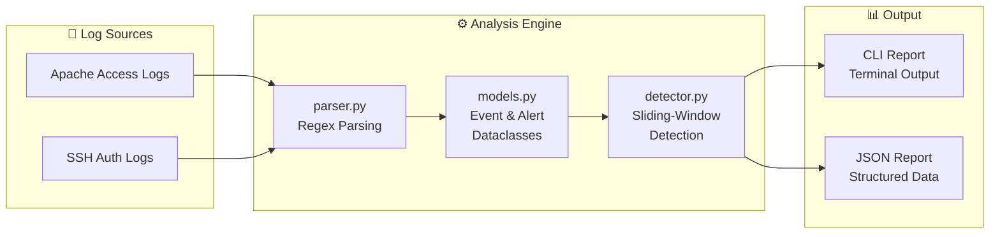
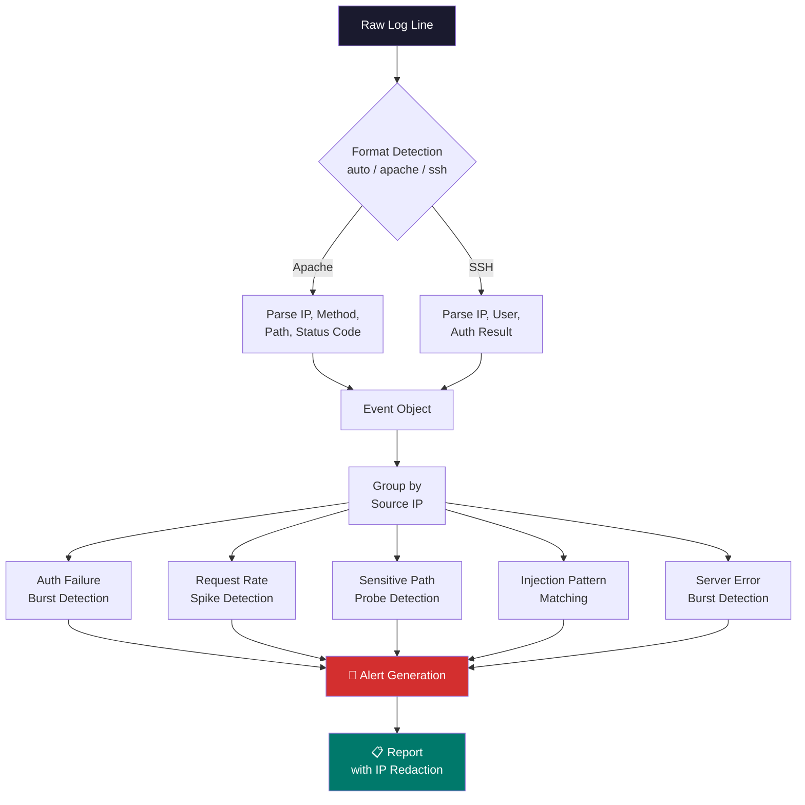
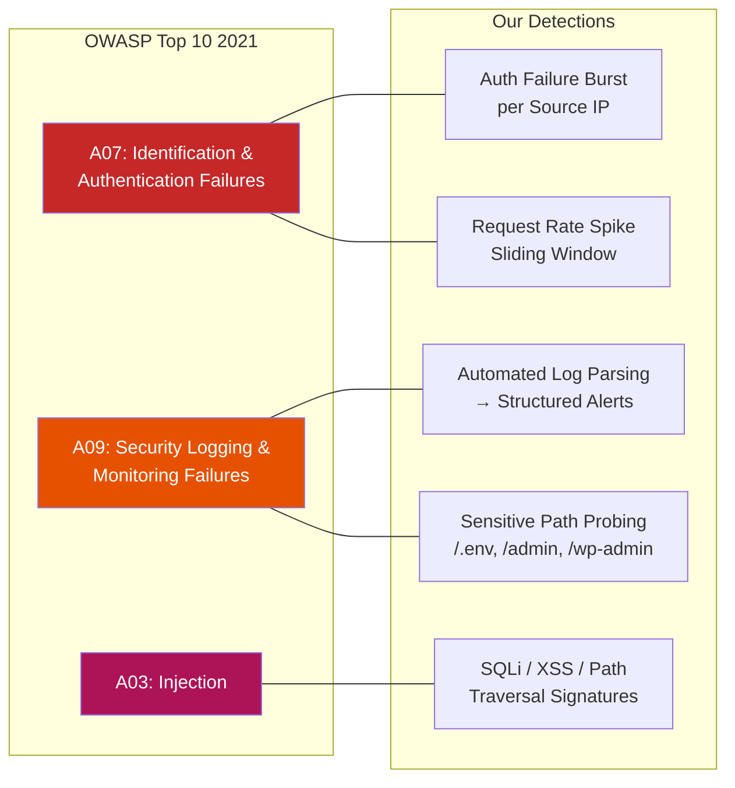
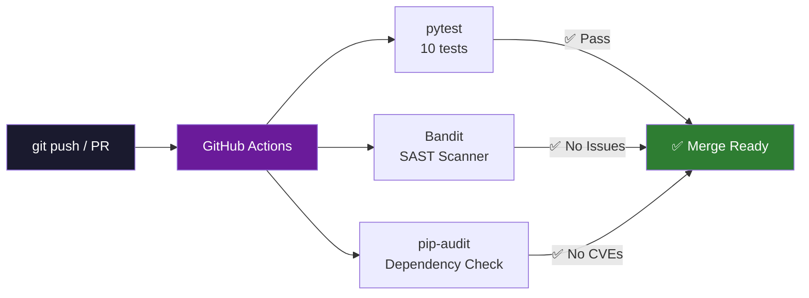

# 🛡️ AppSec Log Analyzer

> **A Python-based Application Security tool that analyzes Apache & SSH logs to detect intrusion attempts, brute-force attacks, and suspicious web request patterns.**


---

## 📐 System Architecture



---

## 🔍 Detection Pipeline



---

## 🎯 OWASP Top 10 Mapping



---

## 🚨 What It Detects

| Alert Category | Severity | Description |
|---|---|---|
| `authentication_failure_burst` | 🔴 HIGH | Brute-force: repeated HTTP 401/403 or SSH auth failures per IP |
| `sensitive_path_probe` | 🔴 HIGH | Scanning for `/.env`, `/admin`, `/wp-admin`, `/phpmyadmin`, `/debug` |
| `sensitive_resource_probe` | 🔴 HIGH | Direct access to config/repo paths (`/.env`, `/.git`, `/actuator`) |
| `path_traversal_probe` | 🔴 HIGH | `../../etc/passwd` style directory traversal |
| `sql_injection_probe` | 🔴 HIGH | `UNION SELECT`, `OR 1=1`, `DROP TABLE` patterns |
| `xss_probe` | 🔴 HIGH | `<script>`, `javascript:`, `onerror=` injection |
| `request_rate_spike` | 🟡 MEDIUM | Unusual request volume in sliding time window |
| `server_error_burst` | 🟡 MEDIUM | Cluster of HTTP 5xx errors (may indicate exploitation) |

---

## 📁 Project Structure

```mermaid
flowchart TD
    ROOT["appsec-log-analyzer/"]
    ROOT --> PKG["appsec_log_analyzer/"]
    ROOT --> TESTS["tests/"]
    ROOT --> SAMPLES["samples/"]
    ROOT --> DOCS["docs/"]
    ROOT --> LEGACY["legacy/java/"]
    ROOT --> CI[".github/workflows/"]

    PKG --> INIT["__init__.py"]
    PKG --> MAIN["__main__.py"]
    PKG --> PARSER["parser.py\nApache + SSH parsing"]
    PKG --> DETECTOR["detector.py\nDetection engine"]
    PKG --> MODELS["models.py\nEvent & Alert models"]
    PKG --> CLIM["cli.py\nCLI interface"]

    TESTS --> TP["test_parser.py\n4 tests"]
    TESTS --> TD["test_detector.py\n6 tests"]

    SAMPLES --> SA["sample_apache.log.txt"]
    SAMPLES --> SS["sample_ssh.log.txt"]

    DOCS --> PDF["legacy-java-report.pdf"]
    DOCS --> PPT["Presentation.pptx"]

    CI --> YML["security.yml\npytest + Bandit + pip-audit"]

    style ROOT fill:#0B1D3A,color:#fff
    style PKG fill:#00796b,color:#fff
    style TESTS fill:#1565c0,color:#fff
    style CI fill:#6a1b9a,color:#fff
```



---

## ⚡ Quick Start

```bash
# Clone and setup
git clone https://github.com/vijjada/PROJECT-NAME---LOG-FILE-ANALYZER-FOR-INTRUSION-DETECTION.git
cd PROJECT-NAME---LOG-FILE-ANALYZER-FOR-INTRUSION-DETECTION
python3 -m venv .venv
source .venv/bin/activate
pip install -r requirements-dev.txt

# Run tests
python -m pytest -v

# Analyze Apache logs
python -m appsec_log_analyzer \
  --input samples/sample_apache.log.txt \
  --json-out reports/apache-report.json

# Analyze SSH logs
python -m appsec_log_analyzer \
  --input samples/sample_ssh.log.txt \
  --format ssh \
  --json-out reports/ssh-report.json

# Redact IPs before sharing
python -m appsec_log_analyzer \
  --input samples/sample_apache.log.txt \
  --redact-ips \
  --json-out reports/redacted-report.json
```

---

## 🔧 CLI Options

| Flag | Default | Description |
|---|---|---|
| `--input` | `samples/sample_apache.log.txt` | Log file to analyze |
| `--format` | `auto` | Log format: `auto`, `apache`, or `ssh` |
| `--window-seconds` | `60` | Sliding window duration for detection |
| `--auth-failure-threshold` | `5` | Auth failures before alerting |
| `--request-threshold` | `10` | Requests before rate-spike alert |
| `--probe-threshold` | `5` | Distinct sensitive paths before alerting |
| `--json-out` | *(none)* | Write structured JSON report |
| `--redact-ips` | `false` | Mask IPs to /24 (IPv4) or /64 (IPv6) |

---

## 🧪 CI/CD Security Pipeline



---

## 🔒 Security & Privacy Notes

- **No network calls** — all analysis is local, offline, stdlib-only at runtime
- **No real passwords or credentials** stored anywhere in the codebase
- **IP redaction** available via `--redact-ips` before sharing reports
- **Synthetic sample logs** use RFC 5737 documentation-only IP ranges (`192.0.2.x`, `198.51.100.x`, `203.0.113.x`)
- **Bandit-clean** — zero security findings in static analysis

---

## ⚠️ Limitations

This is a **classroom prototype**, not a production SIEM, WAF, or IDS/IPS.

- Thresholds are configurable but not tuned for any specific service
- NAT, proxies, shared clients, and clock skew can affect results
- Injection signatures are illustrative and may produce false positives/negatives
- No traffic is blocked; no automated remediation is performed
- Alerts are **leads for human review**, not proof of malicious activity

---

## 📄 Legacy

The original Java implementation is archived in [`legacy/java/`](legacy/java/).
The original research report is at [`docs/legacy-java-report.pdf`](docs/legacy-java-report.pdf).

---

## 👨‍💻 Author

**Vijjada Prem Sai**

## 📜 License

MIT — See [LICENSE](LICENSE)
